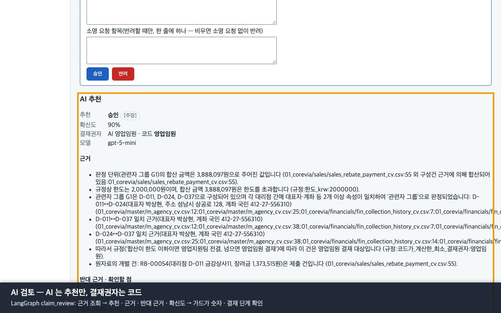
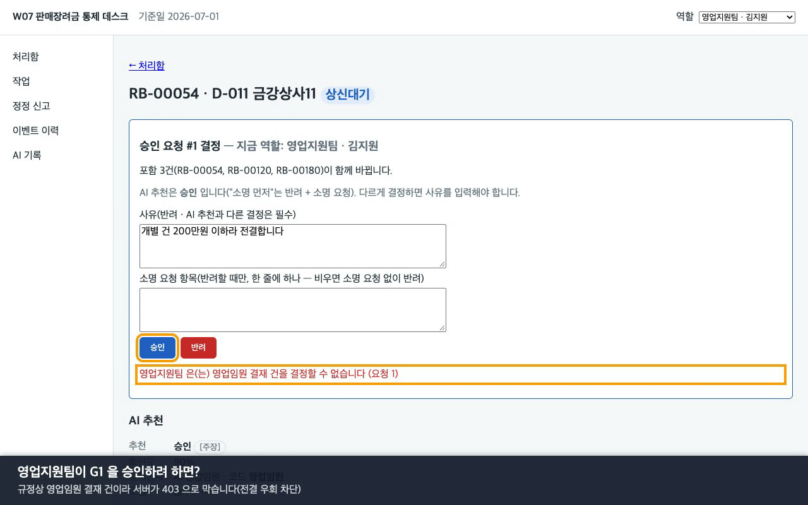
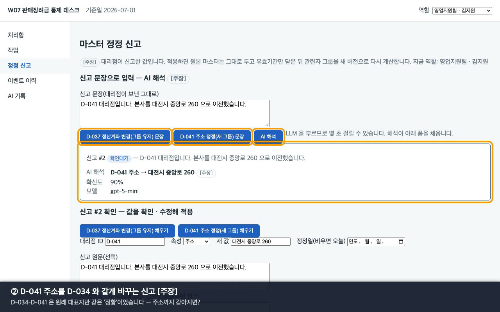
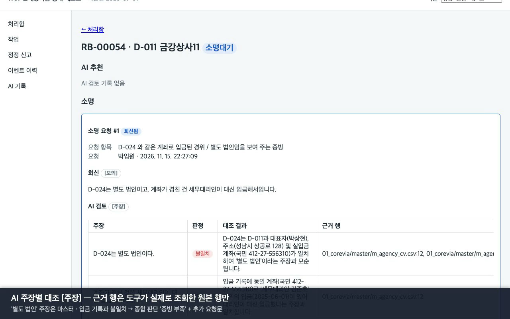
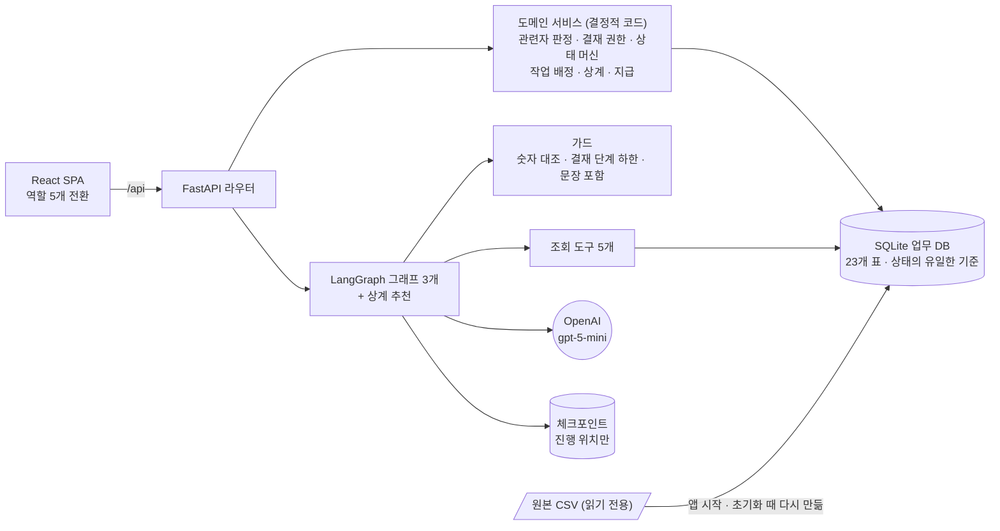

# 관련 거래처 판매장려금 통제 데스크

> 장려금을 지급하기 전에 **관련 거래처를 찾아 금액을 합산하고 → 결재권자를 코드로 정하고 → 연체 채권과 상계**하는 AI 운영 시스템.
> AI 는 판단 · 추천만 하고, 결정은 사람이 하며, 결재 단계는 코드가 지킨다.

- **배포 앱**: https://related-party-rebate-agent-h6nw.axhub.app (오른쪽 위에서 역할을 "시연 관리자"로 바꾸면 시연 패널)
- **API 문서**: https://related-party-rebate-agent-h6nw.axhub.app/docs
- **출제**: 삼일PwC AX 인재전쟁(FDE) 과제 W07 "관련 거래처와 판매장려금 지급" · 1인 개발 · 2026-11-11 ~ 11-15
- **설계 문서**: [제출서](docs/W07_제출서.md) · [설계안](docs/W07_설계안.md) · [아키텍처 · ERD · 상태도](docs/architecture.md)



---

## 1. 문제 — 규정은 있는데 지급 기록이 그걸 안 지켰다

회사 규정은 "거래처별 월 지급액 **200만원 이하는 영업지원팀 전결**, 초과는 영업임원 승인, **같은 관련자는 합산**해 한도를 적용"이다.
그런데 원본 지급 기록은 **건마다의 금액만 보고** 전결됐다.

- 대표자 · 주소 · 계좌가 겹치는 대리점 3곳(G1 = D-011 · D-024 · D-037)은 합치면 매달 406만 ~ 487만원을 받았다.
- 건마다는 200만원 이하라서 1 ~ 5월 **15건 22,238,349원이 영업임원 승인 없이 전결 지급**됐다.
- 같은 G1 은 120일 넘은 **연체 채권**이 있는데 장려금은 현금으로 나갔다.
- 관련자를 알아보는 데 필요한 정보(실제 입금 계좌)는 재무 파일에만 있어서, 영업 결재 화면에는 보이지 않았다.

이 시스템은 같은 6월분 G1 3건을 **합산 3,888,097원 → 영업임원 상신**으로 보내고, 승인되면 연체 채권 29,202,840원과의 상계를 검토한다.
숫자는 모두 원본 CSV 로 직접 계산했고 자동 테스트로 고정했다.

## 2. 무엇을 하는가

| 단계 | 누가 | 무엇을 | 누가 결정하나 |
| --- | --- | --- | --- |
| 접수 · 판정 | 시스템 | 6월분 40건 접수 → 관련자 그룹 판정 → 그룹 월 합산 → 최소 결재권자 계산 | **코드** |
| AI 검토 | AI | 승인 · 반려 · "소명 먼저" 추천, 근거 · 반대 근거 · 확신도 | 추천만 |
| 결재 | 영업지원팀 · 영업임원 | 전결 또는 상신 건 결정. 권한이 모자라면 **403** | **사람** |
| 상계 (확장) | 재무 · 영업 · 대리점 | 같은 그룹의 90일 넘은 연체 채권 조회 → 상계 한도 계산 → AI 상계액 추천 → 영업 의견 → 재무 결정 → 대리점 동의 [모의] | 사람 |
| 지급 | 재무 · 은행 | 지급 지시 → 은행 회신 [모의] → 지급완료 · 지급보류 | 사람 |
| 소명 | 대리점 · AI · 영업지원팀 | 반려된 건에 소명 요청 → 회신을 AI 가 원본과 주장별로 대조 → 증빙 충분이면 재판정 · 재상신, 부족이면 지급보류 | 사람 |
| 마스터 정정 | 영업지원팀 | 신고 문장을 AI 가 해석 → 확인 후 적용 → 그룹이 바뀌면 영향 건 재판정 | 사람 |
| 사후 검토 | 내부감사 | 이미 지급된 196건을 같은 판정 코드로 다시 계산 → 위반 15건마다 감사 작업 | 사람 |

모든 상태 변경은 이력(`event_log`)에 한 줄씩 남고, 상태가 바뀔 때마다 그 부서의 할 일(`task`)이 자동으로 열리고 닫힌다.
화면 · 데이터에는 출처를 **[원본]** 원본 기록 · **[주장]** 부서 · 대리점 · AI 의 주장 · **[가정]** 내가 정한 기준 · **[모의]** 모의 외부 회신으로 구분해 표시했다.

| 결재 우회 차단 (403) | 마스터 정정 → 새 그룹 G2 → 재상신 |
| --- | --- |
|  |  |

## 3. AI 설계 — 면접에서 설명할 핵심 5가지

### ① AI 는 결재 단계를 올릴 수만 있고, 내릴 수는 없다
최소 결재권자는 `services/approval_authority.py` 가 계산한다. AI 가 "영업지원팀 전결이면 된다"고 답해도
가드(`agents/guards.py`)가 코드 값(영업임원)으로 올려 고정하고, 그 사실을 기록한다.
→ LLM 이 틀려도 통제가 뚫리지 않는다.

### ② 사람이 먼저 결정하고, 그다음에 그래프를 재개한다
LangGraph 는 `Command(resume=값)` 을 받는 **순간** 그 값을 체크포인트에 저장한다.
그래서 재개 뒤 노드에서 권한 오류(403)가 나면, 다음 재개 때 새 값이 무시되고 **처음의 틀린 값**으로 다시 돈다(직접 시험해서 확인).
→ 결정 API 가 서비스(권한 · 상태 검사 + 상태 변경)를 **먼저** 부르고, 통과했을 때만 그래프를 재개하는 순서로 바꿨다.
그래프의 마지막 노드는 상태를 바꾸지 않고 "AI 추천과 사람 결정이 일치했는지"만 기록한다.

### ③ 업무 상태는 DB 한 곳에만 둔다
LangGraph 체크포인트에는 "그래프가 어디까지 왔는지"만 있다. 장려금 건의 상태 14개는 업무 DB 에만 있고,
상태를 바꾸는 길은 전이표(`services/claim_state.py`)를 지나는 `transition()` 하나뿐이다.
→ 허용되지 않은 전이는 409, 모든 전이는 이력과 부서 작업을 남긴다.

### ④ AI 의 근거는 도구가 돌려준 원본 행만 인정한다
소명 검토 에이전트(`explanation_review`)는 대리점 · 입금 · 미수채권 · 관련자 그룹 조회 도구 5개를 `bind_tools` 로 직접 반복 호출한다.
"D-024 는 별도 법인"이라는 주장을 실제 마스터 · 입금 기록과 대조해 **불일치 · 확인불가**를 내고, 근거 행이 없는 판정은 "확인불가"로 내린다.
정정 신고 해석(`master_change_parser`)도 "AI 가 말한 대리점 · 새 값이 신고 문장에 실제로 있는가"를 코드로 검사한다.



### ⑤ AI 와 다르게 결정하면 사유가 필요하고, 키가 없어도 업무는 돈다
- 사람이 AI 추천과 다르게 결정하면 서버가 사유를 요구한다(422). AI 기록 화면에서 AI 4종의 추천 · 결정 일치율 · 대체 모드 · 결재 단계 올림을 모아 본다.
- LLM 키가 없거나 2번 실패하면 **대체 모드**로 규정 결과만 남기고 업무는 그대로 진행된다. 테스트 447개는 LLM 없이 돈다.

| AI | 방식 | 입력 → 출력 |
| --- | --- | --- |
| `claim_review` | LangGraph (검증 실패 시 1회 재생성 → 대체 모드, interrupt 로 사람 결정 대기) | 건 · 그룹 합산 · 관련자 근거 → 추천 · 결재권자 · 근거 · 확신도 |
| `explanation_review` | LangGraph + 도구 반복 | 소명 회신 → 주장별 일치 · 불일치 · 확인불가 + 근거 행 → 증빙 충분 · 부족 |
| `master_change_parser` | LangGraph | 정정 신고 문장 → 대리점 · 속성 · 새 값 |
| 상계액 추천 | 구조화 출력 1회 + 가드 | 연체 채권 · 상계 한도 · 영업 의견 → 상계액(0 ~ 한도) |

## 4. 아키텍처



- 컨테이너 1개 · 주소 1개: FastAPI 가 `/api` 와 React 빌드 결과를 함께 서빙한다.
- 요청 하나 = 트랜잭션 하나. 중간에 실패하면 상태 변경 · 이력 · 작업이 모두 롤백된다.
- 관련자 판정: 대표자 · 주소 · 계좌 중 **2개 이상 같으면 관련자**, 쌍을 유니온-파인드로 묶어 그룹을 만들고 **버전 단위**로 저장한다(정정하면 새 버전 → 지난 판정의 근거가 남는다).
- 자세한 그림(페이지 흐름 · AI 워크플로 · ERD · 상태도)은 [docs/architecture.md](docs/architecture.md).

## 5. 시연 시나리오 3개

| 상황 | 무엇이 일어나나 |
| --- | --- |
| **정상** | 단독 37건 전결 → 지급 지시 → 은행 회신 성공. G1 3건은 합산 3,888,097원 → 영업임원 상신. 영업지원팀이 승인하려 하면 403. 영업임원 승인 → 상계 검토 → 영업 부분 상계 의견 70만원 → 재무 결정 → 대리점 동의 → 차액 673,515원 지급. 내부감사 사후 검토로 1 ~ 5월 위반 15건 발견 |
| **조건 변경** | "D-037 정산계좌 변경" 신고 → 실제 입금 계좌가 여전히 G1 공유계좌라 **G1 유지, 영향 0건**(근거 쌍 표시). "D-041 주소를 D-034 와 같게" 신고 → 새 그룹 **G2 합산 2,255,709원 > 한도** → 전결 대기 2건이 **상신대기로 재판정** |
| **승인 거절 · 정보 부족** | 영업임원이 G1 을 반려하고 소명 요청 → 대리점 회신 "D-024 는 별도 법인" → AI 가 원본과 대조해 **불일치** → AI 와 다르게 "증빙 충분"을 사유 없이 누르면 422 → 증빙 부족 → **지급보류** / 다른 건은 증빙 충분 → 재판정 → **재상신** |

배포 앱에서 역할을 "시연 관리자"로 바꾸면 시연 패널에서 세 시나리오를 버튼으로 다시 돌릴 수 있다. "초기화"를 누르면 원본 상태로 돌아간다.

## 6. 기술 스택

| 영역 | 사용 |
| --- | --- |
| 백엔드 | Python 3.12 · FastAPI 0.141 · SQLAlchemy 2.0 · Pydantic v2 · pydantic-settings |
| AI | LangGraph 1.2 · LangChain 1.3 · langchain-openai · OpenAI gpt-5-mini (추론 강도 low) |
| 프론트 | React 19 · Vite 8 · TypeScript 7 · react-router 8 (UI 라이브러리 없음) |
| DB | SQLite (앱 시작마다 원본 CSV 로 다시 만듦) |
| 품질 | pytest 447개 · ruff check / format · `tsc` 빌드 |
| 배포 | Docker · AXHub (git push → 자동 빌드 · 배포) |
| 개발 도구 | Claude Code (설계 · 코드 리뷰 · 검증 · 시연 녹화 자동화) |

## 7. 트러블슈팅

| 증상 | 원인 | 해결 |
| --- | --- | --- |
| 권한 오류 뒤 다시 결정해도 그래프가 처음의 틀린 결정으로 돎 | LangGraph 가 resume 값을 받는 즉시 저장 | 서비스 검사 · 상태 변경 → 통과 시에만 재개 (3장 ②) |
| 배포 앱에서 상계 추천이 대체 모드로 떨어지고, 동시에 다른 요청이 `database is locked` | gpt-5-mini 기본 추론이 길어 30초 타임아웃 2번 → 그동안 SQLite 쓰기 잠금 유지 | `reasoning_effort=low` + 타임아웃 90초, SQLite 잠금 대기 30초. 6초 동안 잠금을 잡는 테스트로 기본값(5초)이면 실패함을 확인. 상계 추천 시간 초과 → 12초 |
| 공유 계좌 하나 때문에 "2개 일치"로 관련자 판정 | 등록 계좌와 실입금 계좌를 따로 셈 | 계좌를 속성 하나(등록 + 실입금 묶음)로 셈 |
| 로컬 Docker 빌드에서 원본 폴더 COPY 실패 | macOS 디스크의 한글 폴더 이름은 NFD, git · Dockerfile 은 NFC | `git archive` 로 푼 폴더에서 빌드 (배포 서버는 git 기준이라 문제없음) |
| 상태 값이 DB 에 `PAID` 처럼 영문 멤버 이름으로 저장 | SQLAlchemy `Enum` 은 멤버 이름을 저장 | `StrEnum` + `String` 컬럼으로 한글 값 저장 |

## 8. 실행 방법

```bash
python -m pip install -r backend/requirements.txt
npm --prefix frontend ci && npm --prefix frontend run build
(cd backend && python -m uvicorn app.main:app --port 8000)   # http://localhost:8000
```

```bash
(cd backend && python -m pip install -r requirements-dev.txt && python -m pytest -q)   # 447 passed
```

- AI 를 켜려면 `backend/.env.example` 을 `backend/.env` 로 복사하고 `LLM_PROVIDER=openai`, `OPENAI_API_KEY` 를 넣는다. 비워 두면 대체 모드로 동작한다.
- Docker: `docker build -t rebate-agent .` → `docker run -p 8080:8080 rebate-agent`

## 9. 폴더 구조

```text
backend/app/
  agents/      LangGraph 그래프 · 가드 · 프롬프트 · 조회 도구 · LLM 게이트웨이 · 실행기
  services/    관련자 판정 · 결재 권한 · 상태 머신 · 작업 배정 · 결재 · 상계 · 지급 · 소명 · 정정 · 사후 검토
  api/routes/  FastAPI 라우터
  models/      SQLAlchemy 모델 (23개 표)
  schemas/     API 요청 · 응답 (Pydantic)
  seed/        원본 CSV → 업무 DB
  mocks/       은행 · 대리점 모의 회신
backend/tests/ pytest 40개 파일 · 447개
frontend/src/  처리함 · 건 상세 · 작업 · 이벤트 이력 · 정정 신고 · AI 기록 · 시연 패널
docs/          제출서 · 설계안 · 아키텍처
```

## 10. 개발 방식과 한계

**개발 방식**
- 로드맵 00 ~ 26 을 항목마다 브랜치 → PR → 머지로 진행했다(PR 29개).
- 단계마다 설계 결정과 그 이유를 기록했다: 무엇을 왜 정했는지, 어떤 안을 왜 버렸는지.
- AI 코딩 도구(Claude Code)와 함께 개발했다. 정답 코드를 직접 읽고 대조한 뒤 반영했고, 모든 단계를 ruff · pytest · 빌드 · 브라우저 확인으로 검증한 뒤 머지했다.

**한계와 다음 단계**
- 로그인이 없다. 역할은 화면에서 고르는 값이고, 권한 검사(403)는 서버가 그 역할 값으로 한다. 실제 서비스라면 인증 토큰에서 역할을 읽어야 한다.
- 긴 LLM 호출 중에는 다른 쓰기 요청이 잠금을 기다린다. 지금은 잠금 대기를 늘려 완화했고, 근본 해결은 LLM 호출을 DB 쓰기보다 앞으로 옮기는 것이다.
- 업무 DB 는 재시작 · 재배포 때 원본 상태로 초기화된다(시연용 설계).
- 상계 기준(90일 초과 · 관련자 그룹 건만)과 대리점 동의 절차는 내가 정한 [가정]이다.

---

<details>
<summary>대회 폴더 안내 (주최 측 원문)</summary>

# AX 인재전쟁 ONLINE · 삼일PwC 프로젝트 폴더

이 폴더가 프로젝트 루트예요. 문제 자료와 내 프롬프트 기록 설정이 함께 들어 있어요.

## 시작하기
1. 이 폴더(이 README.md 가 있는 폴더)를 AI 도구에서 프로젝트(작업 공간)로 열어요. 하위 폴더가 아니라 **이 폴더**를 열어야 기록이 수집돼요.
2. 처음 열 때 한 번 승인해요.
   - Claude Code: 폴더 신뢰 창에서 신뢰를 골라요. 데스크톱 앱은 새 세션을 만들 때 이 폴더를 작업 폴더로 골라요.
   - Codex CLI: 「Hooks need review」 창에서 Trust all and continue.
   - Codex 데스크톱 앱: 창이 뜨지 않아요. 설정 > Hook > 프로젝트에서 제공 > 모두 신뢰.
   - Codex VS Code 확장: 창이 뜨지 않아요. Codex 패널 톱니바퀴 > Codex settings > Hooks > From Projects > Trust all.
   - Antigravity: 승인할 것이 없어요. 사이드바의 Create Project 에서 이 폴더를 골라 열어요.
   신뢰한 뒤에는 새 대화를 열어요. 이미 열려 있던 대화는 예전 설정을 계속 써요.
3. 테스트 프롬프트(예: 안녕하세요)를 보내고, 참가 페이지 「문제 풀이 환경 › 기록 연결 확인」의 최근 프롬프트에 그 문장이 보이는지 확인해요.
   AI 도구를 이 폴더를 받기 전부터 켜 두었다면 재시작해요(도구는 시작할 때 설정을 읽어요).

## 꼭 지켜 주세요
- 풀이부터 앱 개발까지 이 폴더에서 해요. 다른 폴더에서 나눈 대화는 수집되지 않아요.
- .claude · .codex · .agents 폴더와 .gitignore 는 지우거나 고치지 마세요. 참가 신청에 묶인 개인 기록 키가 들어 있어 다른 사람과 나누면 안 돼요.
- 소스코드를 zip 으로 낼 때는 이 세 폴더를 빼고 묶어요.
- 기록은 기기가 아니라 기록 키로 모여요. 다른 기기에서 작업하면 이 폴더를 그대로 옮기거나 그 기기에서 다시 내려받아요.
- 이 폴더는 Mac·Linux 용이에요. Windows 에서 작업하려면 Windows 용으로 다시 내려받아요.

</details>
