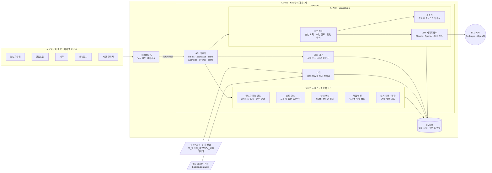
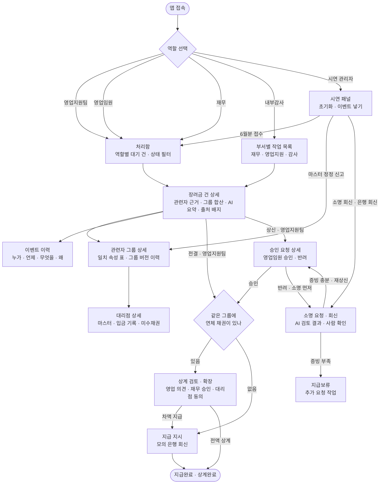
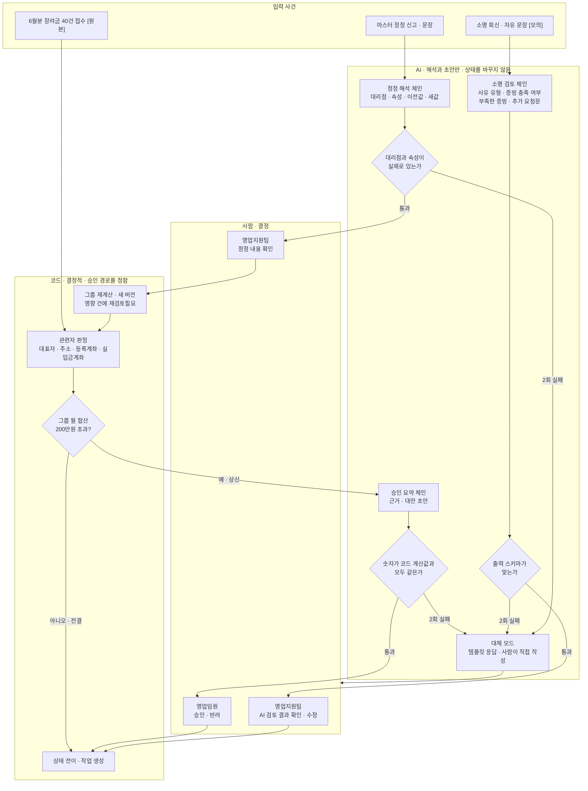
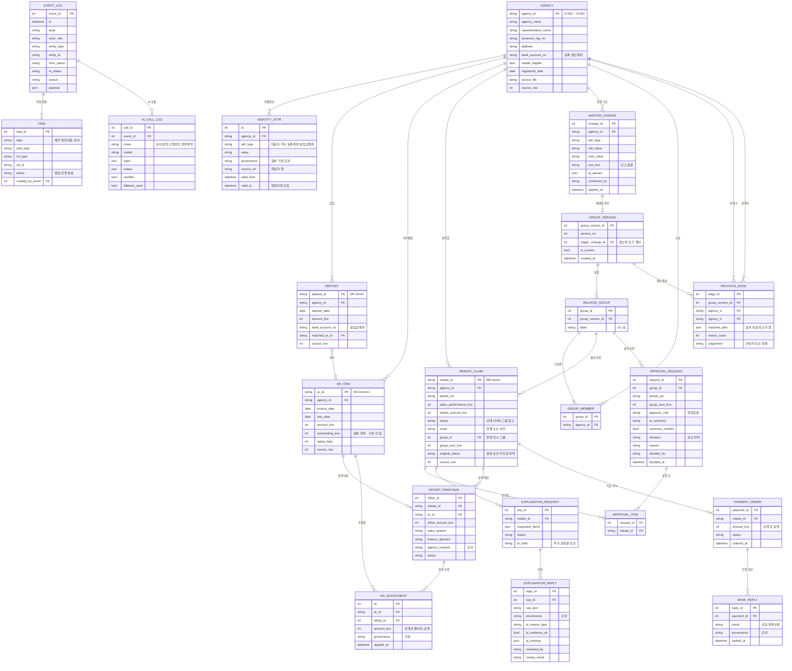

# W07 판매장려금 통제 데스크 — 설계 다이어그램

> 기준: [W07_설계안.md](W07_설계안.md) v0.1 · 스택 FastAPI + SQLite + React(Vite) + LangChain · 배포 AXHub
> 데이터 출처 표기: **[원본]** 원본 기록 · **[주장]** 부서 주장 · **[가정]** 교육용 가정 · **[모의]** 모의 회신

---

## 1. 시스템 아키텍처

- 배포 단위는 **컨테이너 1개, 주소 1개**다. FastAPI가 `/api`와 React 빌드 결과(`dist`)를 함께 내보낸다.
- **승인 경로는 코드가 정한다.** AI는 해석과 초안만 만들고, 상태는 바꾸지 못한다.
- 원본 CSV는 읽기만 한다. 앱이 켜지거나 초기화할 때 원본으로 SQLite 초기 상태를 다시 만든다.

---

## 2. 페이지 흐름도

- 같은 화면이라도 역할에 따라 보이는 버튼이 다르다. 예: 상신 건의 승인 버튼은 영업임원에게만 보인다.
- 시연 패널은 외부에서 들어오는 사건(접수, 정정 신고, 모의 회신)을 넣는 곳이다. 그 뒤 처리는 시스템이 한다.

---

## 3. AI 워크플로우

- AI가 쓰이는 곳은 세 군데다. **승인 요약**, **소명 검토**, **정정 해석**.
- 모든 AI 출력은 검증기를 거친다. 2번 실패하면 대체 모드(템플릿 응답)로 넘어간다.
- AI 결과는 반드시 사람이 확인한 뒤에만 상태 전이로 이어진다. 모든 AI 호출은 `AI_CALL_LOG`에 남는다.

---

## 4. ERD

- 원본 테이블(`AGENCY`, `DEPOSIT`, `AR_ITEM`, `REBATE_CLAIM`)은 `source_file`, `source_row`로 원본 행까지 추적한다.
- 원본 값은 덮어쓰지 않는다. 상계로 줄어든 채권은 `AR_ADJUSTMENT`에, 정정된 마스터는 `MASTER_CHANGE`와 `IDENTITY_ATTR`의 유효기간으로 남긴다.
- 관련자 그룹은 **버전 단위**로 다시 계산한다. 정정이 들어오면 새 `GROUP_VERSION`이 생기고, 이전 판단의 근거는 그대로 남는다.

