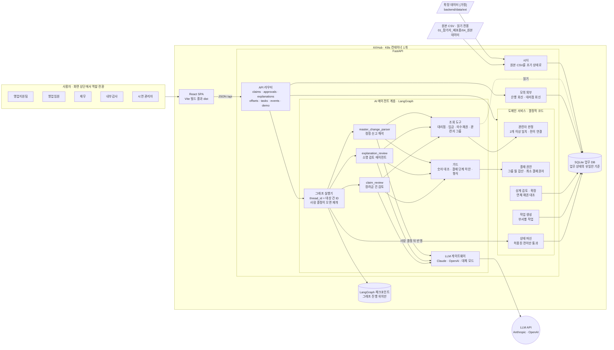
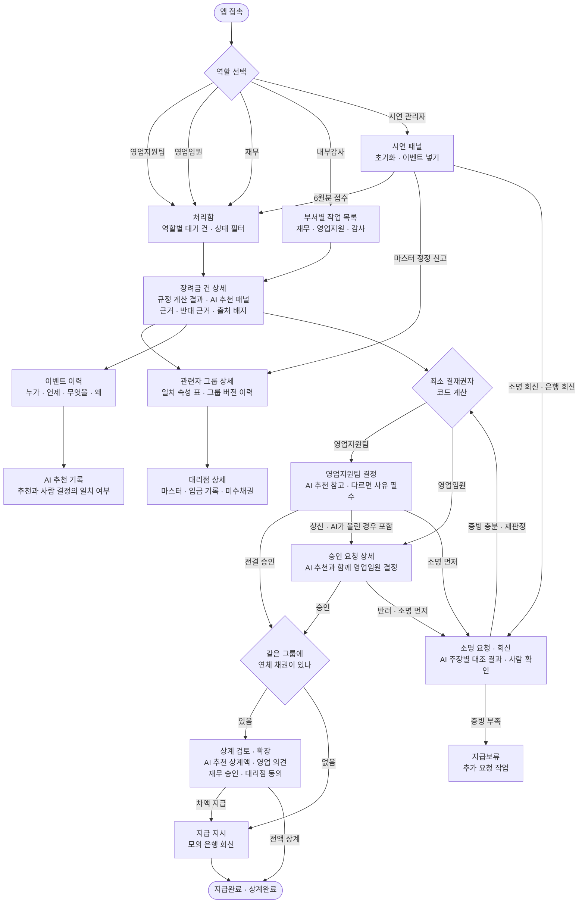
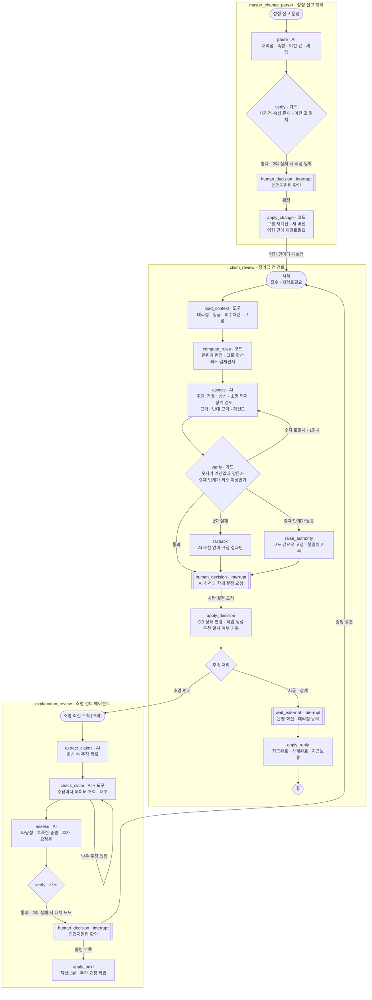
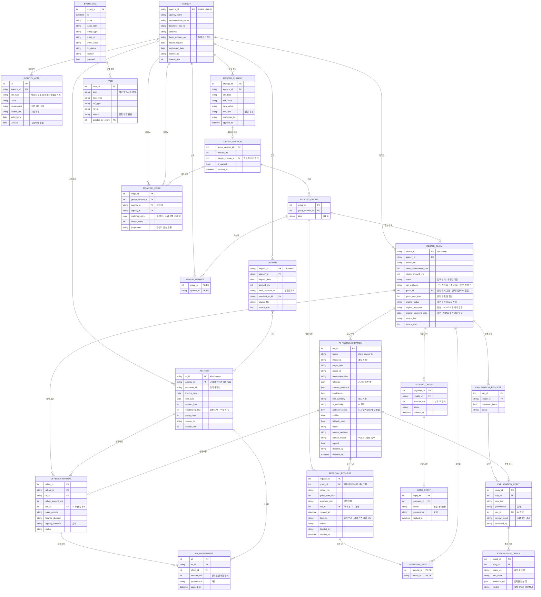
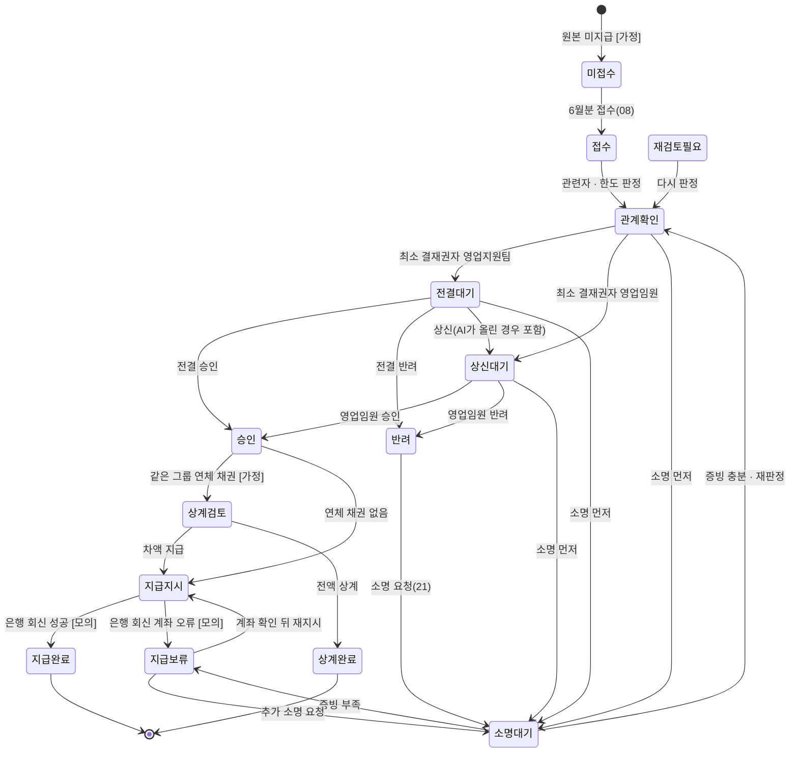

# W07 판매장려금 통제 데스크 — 설계 다이어그램 (v0.2)

> 기준: [W07_설계안.md](W07_설계안.md) v0.2 · 스택 FastAPI + SQLite + React(Vite) + LangGraph · 배포 AXHub
> 데이터 출처 표기: **[원본]** 원본 기록 · **[주장]** 부서 주장 · **[가정]** 교육용 가정 · **[모의]** 모의 회신

---

## 1. 시스템 아키텍처

- 배포 단위는 **컨테이너 1개, 주소 1개**다. FastAPI가 `/api`와 React 빌드 결과(`dist`)를 함께 내보낸다.
- **AI가 판단·추천하고 사람이 최종 결정한다.** 단, AI는 결재 단계를 올릴 수만 있고 내릴 수는 없다(가드).
- **업무 상태는 SQLite 업무 DB에만 있다.** LangGraph 체크포인트에는 그래프가 어디까지 진행됐는지만 있다.
- 원본 CSV는 읽기만 한다. 앱이 켜지거나 초기화할 때 원본으로 초기 상태를 다시 만든다.

---

## 2. 페이지 흐름도

- 결재권자는 **코드가 계산한 최소 결재권자** 이상이어야 한다. 같은 화면이라도 역할에 따라 보이는 버튼이 다르다.
- 결정 화면마다 **AI 추천 패널**(추천 · 근거 · 반대 근거 · 확신도)이 있다. 추천과 다르게 결정하면 사유를 반드시 입력한다.
- 시연 패널은 외부 사건(접수, 정정 신고, 모의 회신)을 넣는 곳이다. 그 뒤 처리는 시스템이 한다.

---

## 3. AI 워크플로우 (LangGraph)

- 그래프는 3개다. 그래프 1회 실행 = 대상 건 1개 = thread 1개.
- `[[ ]]` 모양은 **interrupt**다. 그래프가 여기서 멈추고, 사람 결정이나 외부 회신이 오면 이어서 실행된다.
- **상태를 바꾸는 노드는 `apply_*`뿐이다.** 모두 사람 결정 뒤에 있다.
- AI가 결재 단계를 최소 결재권자보다 낮게 판단하면 `raise_authority`가 코드 값으로 고정하고 불일치를 기록한다.

---

## 4. ERD

- 원본 테이블(`AGENCY`, `DEPOSIT`, `AR_ITEM`, `REBATE_CLAIM`)은 `source_file`, `source_row`로 원본 행까지 추적한다.
- 원본 값은 덮어쓰지 않는다. 상계로 줄어든 채권은 `AR_ADJUSTMENT`에, 정정된 마스터는 `MASTER_CHANGE`와 `IDENTITY_ATTR`의 유효기간으로 남긴다.
- 관련자 그룹은 **버전 단위**로 다시 계산한다. 정정이 들어오면 새 `GROUP_VERSION`이 생기고, 이전 판단의 근거는 그대로 남는다.
- `AI_RECOMMENDATION`은 AI 추천과 사람의 최종 결정을 한 행에 함께 남긴다. 추천 일치율을 여기서 계산한다.
- LangGraph 체크포인트 테이블은 라이브러리가 관리하므로 ERD에 넣지 않았다.
- **04 `feat/db-schema` 는 원본 5개 표만 만든다**(`AGENCY` · `IDENTITY_ATTR` · `DEPOSIT` · `AR_ITEM` · `REBATE_CLAIM`). 나머지 표는 처음 쓰는 브랜치에서 추가한다. DB 는 켤 때마다 원본으로 새로 만들므로 마이그레이션 도구는 쓰지 않는다.
- `AR_ITEM` 은 원본 146행(대리점 채권 74 + 고객 채권 72)을 전부 저장한다. 고객 채권은 `customer_id` 만 있고 `agency_id` 는 비어 있다.
- `IDENTITY_ATTR` 초기 행 = 대리점마다 대표자 · 주소 · 등록계좌 3행(`valid_from` = `registered_date`) + 입금마다 실입금계좌 1행(`valid_from` = `deposit_date`) = 150 + 32 = 182행.
- `REBATE_CLAIM.status` 첫 값은 원본 상태에서 옮긴다: 승인 → 지급완료, 반려 → 반려, 미지급 → 미접수 **[가정]**. 원본 값은 `original_status` · `original_approver` · `original_payment_date` 에 그대로 남긴다.
- **05 `feat/related-party-engine` 은 관련자 표 4개를 더한다**(`GROUP_VERSION` · `RELATED_GROUP` · `GROUP_MEMBER` · `RELATION_EDGE`). 버전 1 은 앱을 켤 때 시더 끝에서 계산한다. `trigger_change_id` 는 `MASTER_CHANGE` 와 함께 20 에서, `REBATE_CLAIM` 의 `min_authority` · `group_id` · `group_sum_krw` 는 한도 판정을 하는 06 에서 더한다.
- 판정: 대표자 · 주소 · 계좌 중 2개 이상 같으면 관련자, 1개면 정황. **계좌는 속성 1개**로, 대리점의 등록계좌와 실입금계좌를 한 묶음으로 보고 묶음끼리 하나라도 겹치면 일치다. 지금 유효한 속성(`valid_to` 가 비어 있음)만, 문자열이 정확히 같을 때만 일치로 본다.
- `RELATED_GROUP` 은 **2곳 이상 묶인 그룹만** 저장한다(원본 기준 G1 하나). 그룹이 없는 대리점은 자기 금액만으로 한도를 본다. 라벨은 그룹 안 가장 작은 `agency_id` 순으로 G1, G2 … 를 붙인다.
- `RELATION_EDGE` 는 1개 이상 일치한 쌍만 저장한다(원본 기준 4쌍: 관련자 3 · 정황 1). `agency_a` 가 작은 ID 다. `matched_attrs` 는 일치한 속성마다 값과 양쪽 근거 행(`IDENTITY_ATTR.source_ref`)을 담는다.
- **06 `feat/approval-authority` 는 `REBATE_CLAIM` 에 `min_authority` · `group_id` · `group_sum_krw` 를 더한다.** 셋 다 비어 있을 수 있고, 비어 있으면 아직 판정 전이다. 시더는 채우지 않는다. 대상월 하나를 판정하는 함수가 채우며, 6월분은 08 접수 때 채운다(1~5월 위반은 감사 24 에서 같은 함수로 계산).
- 한도 판정: 대상월(`period_ym`) 기준, 지금 버전 그룹 단위(그룹이 없으면 대리점 혼자)로 반려 건을 뺀 장려금을 합산한다. 2,000,000원 이하면 영업지원팀, 넘으면 영업임원. 단독 대리점도 `group_sum_krw` 에 자기 금액을 넣고 `group_id` 는 비운다. 구성 건은 같은 `group_id` · 같은 대상월로 조회하며 따로 저장하지 않는다.
- **09 `feat/approval-request` 는 `APPROVAL_REQUEST` · `APPROVAL_ITEM` 을 더한다.** 08 접수 때 상신대기로 간 건을 판정 단위마다 묶어 요청 1건을 같은 트랜잭션에서 만든다(원본 기준 G1 요청 1건 · 포함 3건). `rec_id` 는 `AI_RECOMMENDATION` 과 함께 17 에서 더한다. 그룹 근거는 복사하지 않고 `group_id` 로 `RELATION_EDGE` 를 찾는다.
- 결재 권한: 결정하는 역할이 요구 역할(요청의 `approver_role`, 전결 건은 `min_authority`) **이상** 이어야 한다(`ApproverRole` 순서로 비교, 결재권자가 아닌 역할은 항상 부족 → 403). 반려는 사유 필수(422). 이미 결정된 요청 · 건은 상태 머신이 막는다(409). 상신대기 건은 전결 결정 길로 결정할 수 없다(요청 기록 없이 승인되는 것을 막음). 결정자 이름 · 역할은 시연용으로 요청 본문에 담는다(실제 시스템이면 로그인 토큰에서 꺼낸다).

---

## 5. 장려금 건 상태 전이

- 상태는 `REBATE_CLAIM.status` 한 곳에만 있고, 바꾸는 길은 `services/claim_state.py` 하나다. 허용 여부 확인 → 상태 변경 → `EVENT_LOG` 한 줄이 한 함수에서 함께 일어난다(07).
- 전이표는 코드에서 데이터(상태 → 갈 수 있는 상태들)로 두고, 이 그림은 그 표와 같다. 허용되지 않은 전이와 같은 상태로의 전이는 막고, 이유는 모든 전이에서 필수다.
- 원본에서 옮긴 첫 상태(미접수 · 지급완료 · 반려)는 전이가 아니라서 이력을 남기지 않는다.
- 재검토필요는 아직 돈이 나가지 않은 9개 상태에서만 들어온다. 지급지시는 은행에 보낸 지시를 되돌릴 수 없어서, 지급완료 · 상계완료는 끝난 건이라 빠진다(끝난 건은 감사 사후 검토 작업으로 다룬다).
- 역할 권한(누가 어떤 전이를 할 수 있나)은 09 에서 전이 함수 앞에 둔다. 상태 머신은 누가 했는지 기록만 한다.

재검토필요로 들어오는 전이(마스터 정정 · 그룹 버전 변경, 20)는 그림이 복잡해져 화살표 대신 목록으로 적는다: 접수 · 관계확인 · 전결대기 · 상신대기 · 소명대기 · 지급보류 · 승인 · 반려 · 상계검토 → 재검토필요.
